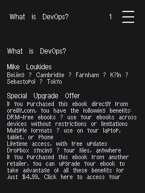
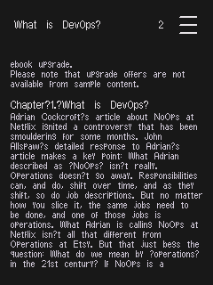
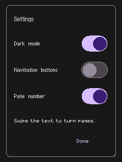

# Reader GUI (MobiReaderApp)

[Back to the README](../README.md)

`src/TinyMobi/MobiReaderApp.h` is a page-by-page reader GUI built with
[TinyMaterialDesign](https://github.com/pschatzmann/TinyMaterialDesign). It has:

- a title bar with the book title, the page number (optional) and the menu icon
- a JPEG cover shown full screen before the first page (a tap or a swipe to the
  left opens the text)
- one page of text, turned by swiping left (next page) or right (previous page).
  The table of contents and the other links of the book are tappable, and the
  headings are drawn in the title font
- optional Previous and Next buttons (hidden by default, see the settings)
- an open dialog for choosing a book: it is shown when no book is open, and can
  be opened from the menu ("Open book")
- a system menu (the menu icon in the title bar) with "Open book", "Go to start",
  "Bookmarks", "Settings", "About" (author, publisher, language and the page
  shown) and, if `onClose` is set, "Close"

The header is optional. It needs TinyMaterialDesign, TinyGPU and
[TinyJPEG](https://github.com/pschatzmann/TinyJPEG) in addition to TinyMobi.
`TinyMobi.h` does not depend on them.

The JPEG cover is shown full screen, before the first page of text. It is
scaled to the largest size that fits the screen with its proportions, and
centred on a black background, so nothing is cut off. The cover is read into
memory and decoded in `begin()`. Covers in other formats (PNG, GIF) are not
shown. A tap or a swipe to the left on the cover opens the text.

## Screenshots

The screenshots were made with the screenshot tool `tools/gui-screenshots` on the
DevOps book, in the 240 x 320 pixel size of the window.

| Cover (first page) | Text | Text, next page | Settings |
|:---:|:---:|:---:|:---:|
|  |  |  |  |

`gui.saveScreenshots(store)` saves the cover, the next three text pages and the
settings screen. The sketch supplies `store`, which opens each file and writes
the image into it. The tool `tools/gui-screenshots` does this, and the PNG files
in `docs/images` were converted from its BMP files.

## Usage

```cpp
#include <SD.h>
#include <TinyMobi.h>
#include <TinyMobi/MobiReaderApp.h>

File file;
tinymobi::FileMobi<File> doc{tinymobi::StreamSource<File>(file)};
tinymobi::MobiReaderApp<RGB565, tinymobi::FileMobi<File>> gui(DefaultBoard, doc);

void setup() {
  file = SD.open("/book.mobi");
  doc.open();   // the document must be open before the GUI is started
  gui.begin();
}

void loop() {
  gui.update();
}
```

`gui.app()` gives access to the TinyMaterialDesign `App`, for example to
`saveScreenshot()`.

## Navigation

- Swipe left on the text to turn to the next page, and swipe right to go back.
  The first text page goes back to the cover.
- `next()` and `previous()` turn the page. The buttons call them.
- `goTo(Position)` starts a new page sequence at a position.
- Tapping a link jumps to its target. Going back (a swipe to the right, or the
  previous button) on the first page of the jump returns to the page the link was
  followed from, for example the table of contents. Up to 32 jumps are remembered.
- `pageNumber()`, `hasNext()` and `hasPrevious()` report the state.
- `onClose` is called when the user chooses "Close" in the system menu. The
  item is only shown when the callback is set.

## Opening a book

The open dialog lists the folder `libraryDir` (the folders first, then the books
whose extension is in `bookExtensions`). A folder is opened by tapping it, ".."
goes to the parent folder, and tapping a book opens it. The reader then shows the
book from its first page. Cancel is shown when a book is already open.

The reader does not read the file system itself. The sketch sets two callbacks:

- `listFiles(dir)` returns the entries of a folder as `tinymd::FileEntry` values
  (name and whether it is a folder).
- `openBook(path)` opens the book into the document and returns `true` on
  success.

The dialog itself is `tinymd::FileDialog` in TinyMaterialDesign
(`Widgets/FileDialog.h`), which works with any file system through the same
callback.

## Table of contents and links

The table of contents is part of the book text. Its entries are links, as in
an HTML page: tapping a link jumps to the place it names. There is no separate
contents panel.

Links are tappable where the link target can be resolved: MOBI6 links
(`filepos`) and KF8 links (`kindle:pos`) of KF8 and hybrid books. A link whose
target cannot be resolved is shown as plain text.

A heading (h1 to h6) is drawn in the title font, on its own line, after an empty
line.

On a page that is mostly links (such as a table of contents) the lines have more
space between them, and a tap is assigned to the nearest line, so the wrong entry
is less likely to be opened.

## Bookmarks

"Bookmarks" opens a list with an "Add bookmark" row for the shown page, and one
row per bookmark that jumps to it. At most 32 bookmarks are kept. They are kept
in memory for the session only; they are lost when the reader is closed.

## Settings

The "Settings" item of the system menu (or `showSettings()`) opens the settings
screen:

- **Dark mode** (on by default): switches between the dark and the light theme.
  `isDark()` and `setDark()` give access to it.
- **Navigation buttons** (off by default): shows the Previous and Next buttons
  at the bottom. `buttonsVisible()` and `setButtonsVisible()` give access to it.
- **Page number** (on by default): shows the number of the page in the title bar,
  just left of the menu icon. `isPageNumberVisible()` and `setPageNumberVisible()`
  give access to it.

Swipes work in both cases.

Each page is read in plain text mode. The text is cut after its last whole word
and then after the last word that fits the text area. The start of each visited
page is remembered, so `previous()` works. The starts of up to `kMaxPages` (4096)
pages are kept, which is enough for books of several hundred pages.

## Limitations

- The pages are not scrolled. A single word that is taller than the text area is
  clipped.
- The TinyMaterialDesign bitmap fonts only cover ASCII. Other characters are
  shown as `?`.
- The book title in the title bar is shortened to the width that is left before
  the page number (or the menu icon).
- Only JPEG covers are shown. The cover bytes are held in a `std::vector` and
  the sprite is allocated while the cover is decoded.
- Images inside the text are not shown yet.
- Going back is possible through the pages that were visited, and through the
  jumps that links made (up to 32). Bookmarks and "Go to start" do not add to it.
- Turning pages in KF8 books is slow: each page is read from the start of its
  part, which takes longer for longer parts.

## Desktop example

`examples/gui-reader` builds the GUI as a desktop program with SDL2:

```sh
cmake -S examples/gui-reader -B build-gui-reader -DTINYMOBI_EXAMPLE_BOOK=/path/to/book.mobi
cmake --build build-gui-reader
./build-gui-reader/gui-reader
```

The screenshot tool `tools/gui-screenshots` saves the cover, the next pages and
the settings screen as BMP images in the directory named by
`TINYMOBI_SCREENSHOTS`, and then exits. It works without a window
(`SDL_VIDEODRIVER=dummy`).
